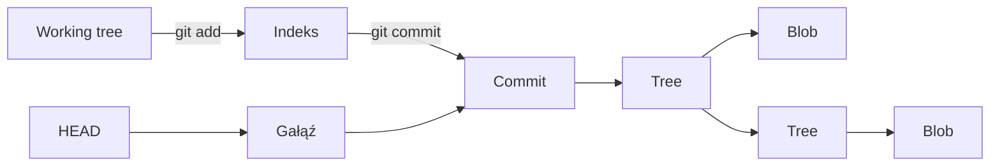

# Git / od środka

> Zobacz, co dzieje się w Git, gdy edytujesz plik, dodajesz go do indeksu i tworzysz commit.

Interaktywne laboratorium do nauki Git. Edytor, staging area i graf obiektów pokazują ten sam projekt z trzech perspektyw — od bieżących zmian po zapisane migawki i ich historię.

**HTML · CSS · JavaScript** &nbsp; | &nbsp; **Bez zależności** &nbsp; | &nbsp; **Działa offline** &nbsp; | &nbsp; **Interfejs PL / EN**

[Uruchomienie](#uruchomienie) · [Pierwszy eksperyment](#pierwszy-eksperyment) · [GitHub Pages](#github-pages) · [Model Git](#model-git) · [Testy](#testy)

---

## Co możesz zrobić

- **Edytować projekt** — tworzyć pliki i foldery, zmieniać ich ścieżki i usuwać je.
- **Przygotowywać commity** — dodawać pojedyncze zmiany lub wszystkie naraz, wycofywać je z indeksu i zapisywać migawki z własną wiadomością.
- **Zaglądać do obiektów Git** — klikać bloby, drzewa i commity, aby zobaczyć ich zawartość oraz powiązania.
- **Pracować na gałęziach** — tworzyć je, przełączać się między nimi i obserwować przesunięcia wskaźników.
- **Przeglądać historię** — przełączać graf między widokiem wszystkich obiektów a historią commitów, powiększać go i przesuwać.
- **Eksperymentować** — cofać ostatnie działania i zaczynać od pustego repozytorium albo przykładu z pierwszym commitem.

Aplikacja jest symulatorem działającym w przeglądarce. Pliki w edytorze należą do symulowanego projektu; aplikacja nie czyta ani nie zmienia repozytoriów na Twoim dysku.

## Uruchomienie

### Bez instalowania czegokolwiek

Otwórz [`index.html`](index.html) w przeglądarce. Wszystkie zasoby aplikacji są lokalne, więc po pobraniu plików możesz korzystać z niej bez internetu.

### Z lokalnym serwerem

Jeśli masz **Node.js 18 lub nowszy**, uruchom w katalogu aplikacji:

```sh
npm start
```

Otwórz [http://127.0.0.1:4173](http://127.0.0.1:4173). Instalowanie zależności i budowanie aplikacji nie są potrzebne.

Aby zmienić port na macOS lub Linux:

```sh
PORT=8080 npm start
```

## Pierwszy eksperyment

Ten przykład pokazuje, dlaczego `git add` zapisuje konkretną wersję pliku, a nie wszystkie jego późniejsze zmiany.

1. Wybierz plik w drzewie projektu, wpisz `wersja A` i kliknij **Zapisz zmiany** lub użyj **Ctrl / ⌘ + S**.
2. Kliknij **+** obok tego pliku w sekcji **Working tree**, aby dodać go do staging area.
3. Zmień treść na `wersja B` i ponownie zapisz plik. Tym razem nie dodawaj go do staging area.
4. Wpisz wiadomość commita i kliknij **Commit**.
5. Kliknij nowy commit w grafie i przejdź przez jego tree do bloba. Zapisana treść to `wersja A`, a w edytorze nadal jest `wersja B`.

Dodaj plik do staging area jeszcze raz i utwórz drugi commit. Zobaczysz nowy blob, nowe drzewa oraz przesunięcie gałęzi. Poprzednia migawka pozostanie dostępna.

### Przydatne kontrolki

| Kontrolka | Działanie |
| --- | --- |
| **Plik / Folder** | Tworzy element pod ścieżką względną, np. `src/components/menu.js` |
| **Ołówek / kosz** w edytorze | Zmienia nazwę lub ścieżkę / usuwa plik albo folder |
| **Dodaj wszystkie** | Zapisuje wszystkie bieżące zmiany w indeksie |
| **+** obok listy gałęzi | Tworzy gałąź wskazującą na bieżący commit |
| **Obiekty / Historia** | Zmienia zakres obiektów pokazywanych w grafie |
| **Cofnij** | Przywraca stan sprzed ostatniej operacji |
| **Zacznij od nowa** | Otwiera wybór początkowego stanu repozytorium |
| **Jak to działa?** | Wyjaśnia model i sposób korzystania z aplikacji |
| **PL / EN** | Zmienia język interfejsu, pomocy i dziennika operacji |

Graf możesz przesuwać, przeciągając tło, a jego węzły wybierać także klawiszami **Tab** i **Enter**. Przed przełączeniem gałęzi symulator wymaga zatwierdzenia zmian.

## GitHub Pages

Aplikacja może być hostowana jako statyczna strona: cała logika działa w przeglądarce, a ścieżki do CSS i skryptów są względne. Na hostingu nie potrzebuje Node.js ani `server.js`.

### Osobne repozytorium aplikacji

1. Umieść zawartość tego katalogu w głównym katalogu repozytorium — `index.html` powinien znajdować się bezpośrednio w jego katalogu głównym.
2. Wyślij pliki na GitHub.
3. Otwórz **Settings → Pages**.
4. W sekcji **Build and deployment** wybierz **Source → Deploy from a branch**.
5. Wybierz gałąź z plikami, np. `main`, oraz folder **/(root)** i kliknij **Save**.
6. Po zakończeniu publikacji otwórz adres wskazany w ustawieniach Pages, zwykle `https://<login>.github.io/<repozytorium>/`.

Do działania strony wystarczy sześć plików:

```text
index.html
styles.css
i18n.js
git-engine.js
graph.js
app.js
```

### Aplikacja w podfolderze większego repozytorium

Jeśli zachowujesz strukturę `aplikacja_git/`, możesz użyć **GitHub Actions** i opublikować zawartość tego folderu jako artefakt GitHub Pages. Przy publikowaniu bezpośrednio z gałęzi GitHub pozwala wybrać tylko katalog główny lub `/docs`, więc nie wybierzesz tam dowolnego podfolderu.

Szczegóły: [konfigurowanie źródła publikacji GitHub Pages](https://docs.github.com/en/pages/getting-started-with-github-pages/configuring-a-publishing-source-for-your-github-pages-site).

## Model Git



| Element | Co reprezentuje |
| --- | --- |
| **Working tree** | Aktualne pliki i foldery edytowanego projektu |
| **Indeks / staging area** | Indeks przechowuje całą planowaną migawkę; staging area pokazuje jej różnice względem HEAD |
| **Blob** | Treść pliku, bez jego nazwy i ścieżki |
| **Tree** | Nazwy, tryby i identyfikatory plików oraz podfolderów |
| **Commit** | Główne drzewo migawki, rodzica i metadane |
| **Branch** | Wskaźnik na commit, przesuwany przy kolejnych commitach na tej gałęzi |
| **HEAD** | Symboliczne wskazanie bieżącej gałęzi |

Obiekty są niezmienne. Identyczna treść daje ten sam identyfikator i jest współdzielona między migawkami. W bazie pozostają również bloby utworzone przez `git add`, a później wycofane z indeksu. Puste foldery mogą istnieć w working tree, ale nie trafiają do commitów.

Identyfikatory obiektów korzystają z SHA-1 i formatu Git, w tym binarnego kodowania drzew. Testy porównują je z wynikiem prawdziwego `git hash-object`.

### Zakres symulacji

Model pomija kompresję, packfile, garbage collection, uprawnienia wykonywalne, symlinki, merge, rebase i zdalne repozytoria. **Cofnij** jest funkcją aplikacji, a polecenia wyświetlane w dzienniku opisują operacje — dziennik nie jest terminalem.

## Zapis sesji

Stan symulowanego repozytorium zapisuje się lokalnie w `localStorage` przeglądarki. Dane nie są wysyłane na serwer ani synchronizowane między urządzeniami. Wybór języka jest zapamiętywany osobno; przełączanie PL / EN zachowuje pliki, gałęzie, wiadomości commitów i bieżącą edycję.

**Niezapisany tekst edytora nie jest utrwalany.** Przed zamknięciem strony kliknij **Zapisz zmiany**. Usunięcie danych witryny z przeglądarki usuwa także zapisaną sesję.

## Struktura projektu

| Plik / katalog | Odpowiedzialność |
| --- | --- |
| [`index.html`](index.html) | Interfejs i kontrolki aplikacji |
| [`styles.css`](styles.css) | Wygląd, responsywny układ i animacje |
| [`git-engine.js`](git-engine.js) | Model repozytorium, SHA-1, indeks i obiekty Git |
| [`graph.js`](graph.js) | Graf SVG, selekcja, powiększanie i przesuwanie |
| [`app.js`](app.js) | Edytor, operacje, okna, dziennik i zapis sesji |
| [`i18n.js`](i18n.js) | Tłumaczenia PL / EN i zapamiętany język |
| [`server.js`](server.js) | Opcjonalny lokalny serwer HTTP bez zależności |
| [`tests/`](tests/) | Testy modelu repozytorium |
| [`design/`](design/) | Referencja wizualna i opis projektu interfejsu |

## Testy

Wymagania: **Node.js 18+** i **Git** dostępny w terminalu. Uruchom w katalogu aplikacji:

```sh
npm test
```

Testy obejmują zgodność identyfikatorów z Git, zapis konkretnych wersji w indeksie, niezmienność poprzednich commitów, współdzielenie obiektów, usunięcia, puste foldery, gałęzie, przenoszenie ścieżek, walidację oraz zapis i odczyt sesji.

## Materiały do nauki

- [Pro Git — Git Objects](https://git-scm.com/book/en/v2/Git-Internals-Git-Objects) — obiekty blob, tree i commit oraz ich format.
- [Pro Git — Recording Changes](https://git-scm.com/book/en/v2/Git-Basics-Recording-Changes-to-the-Repository) — working tree, staging area i zapisywanie zmian.
